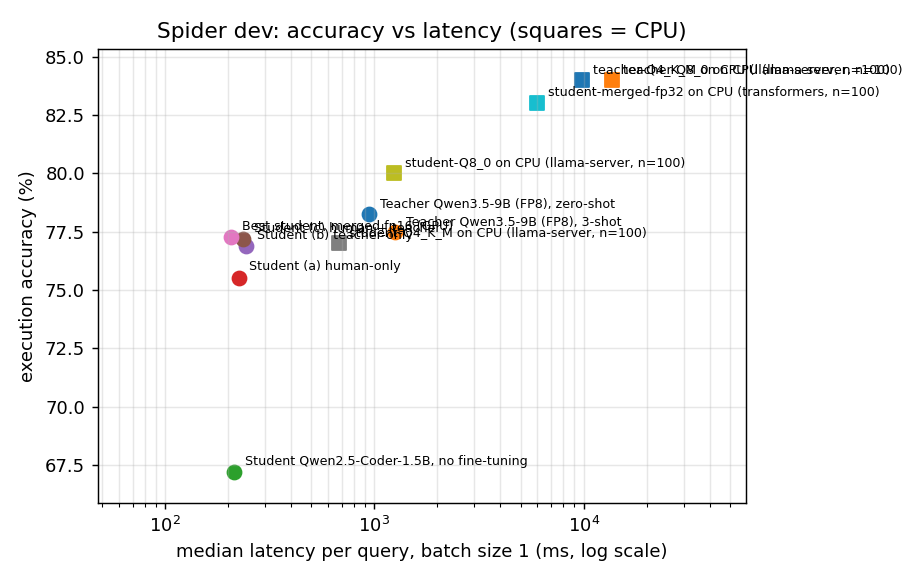
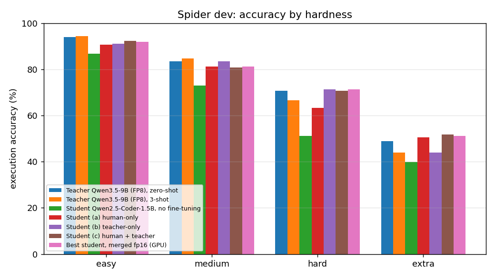
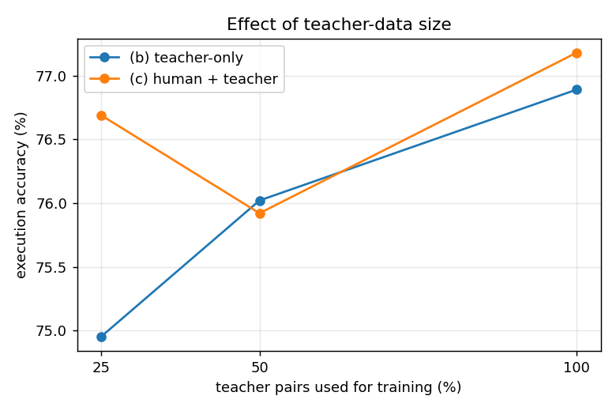

# Results on Spider dev

## Main results

| model | n | EX | easy | medium | hard | extra | p50 ms | p95 ms | q/s (batch) | VRAM GiB | size GiB | device | % of teacher EX | speed-up vs teacher (p50) |
|---|---|---|---|---|---|---|---|---|---|---|---|---|---|---|
| Teacher Qwen3.5-9B (FP8), zero-shot | 1034 | 0.782 | 0.940 | 0.834 | 0.707 | 0.488 | 945 | 2169 | 4.17 | 15.47 | 13.06 | GPU (RTX 4000 Ada) | 100.0 | 1.0 |
| Teacher Qwen3.5-9B (FP8), 3-shot | 1034 | 0.775 | 0.944 | 0.848 | 0.667 | 0.440 | 1252 | 2480 | 1.65 | 15.99 | 13.06 | GPU (RTX 4000 Ada) | 99.0 | 0.8 |
| Student Qwen2.5-Coder-1.5B, no fine-tuning | 1034 | 0.672 | 0.867 | 0.729 | 0.511 | 0.398 | 214 | 598 | 42.71 | 6.52 | 2.89 | GPU (RTX 4000 Ada) | 85.9 | 4.4 |
| Student (a) human-only | 1034 | 0.755 | 0.907 | 0.812 | 0.632 | 0.506 | 224 | 638 | 38.69 | 7.20 | 2.97 | GPU (RTX 4000 Ada) | 96.5 | 4.2 |
| Student (b) teacher-only | 1034 | 0.769 | 0.911 | 0.834 | 0.713 | 0.440 | 244 | 583 | 42.44 | 7.20 | 2.97 | GPU (RTX 4000 Ada) | 98.3 | 3.9 |
| Student (c) human + teacher | 1034 | 0.772 | 0.923 | 0.807 | 0.707 | 0.518 | 235 | 623 | 38.95 | 7.20 | 2.97 | GPU (RTX 4000 Ada) | 98.6 | 4.0 |
| Best student, merged fp16 (GPU) | 1034 | 0.773 | 0.919 | 0.812 | 0.713 | 0.512 | 206 | 550 | 44.08 | 6.52 | 2.89 | GPU (RTX 4000 Ada) | 98.8 | 4.6 |
| student-Q4_K_M on CPU (llama-server, n=100) | 100 | 0.770 | 0.917 | 0.800 | 0.762 | 0.588 | 675 | 4857 | – | 0.00 | 0.92 | CPU: Intel(R) Core(TM) i9-14900K, 32 threads | – | – |
| student-Q8_0 on CPU (llama-server, n=100) | 100 | 0.800 | 1.000 | 0.840 | 0.714 | 0.647 | 1238 | 5086 | – | 0.00 | 1.53 | CPU: Intel(R) Core(TM) i9-14900K, 32 threads | – | – |
| student-merged-fp32 on CPU (transformers, n=100) | 100 | 0.830 | 1.000 | 0.840 | 0.809 | 0.706 | 5984 | 10623 | – | 0.00 | 2.89 | CPU: Intel(R) Core(TM) i9-14900K, 32 threads | – | – |
| teacher-Q4_K_M on CPU (llama-server, n=100) | 100 | 0.840 | 1.000 | 0.880 | 0.905 | 0.529 | 9861 | 18798 | – | 0.00 | 5.38 | CPU: Intel(R) Core(TM) i9-14900K, 32 threads | – | – |
| teacher-Q8_0 on CPU (llama-server, n=100) | 100 | 0.840 | 1.000 | 0.880 | 0.857 | 0.588 | 13670 | 23462 | – | 0.00 | 9.11 | CPU: Intel(R) Core(TM) i9-14900K, 32 threads | – | – |

## Ablation: training data source

| model | EX | easy | medium | hard | extra |
|---|---|---|---|---|---|
| Student Qwen2.5-Coder-1.5B, no fine-tuning | 0.672 | 0.867 | 0.729 | 0.511 | 0.398 |
| Student (a) human-only | 0.755 | 0.907 | 0.812 | 0.632 | 0.506 |
| Student (b) teacher-only | 0.769 | 0.911 | 0.834 | 0.713 | 0.440 |
| Student (c) human + teacher | 0.772 | 0.923 | 0.807 | 0.707 | 0.518 |

## Ablation: amount of teacher data

| variant | teacher pairs used (%) | EX | run |
|---|---|---|---|
| (b) teacher-only | 25 | 0.750 | student-teacher-teacher25pct-zeroshot-dev |
| (b) teacher-only | 50 | 0.760 | student-teacher-teacher50pct-zeroshot-dev |
| (b) teacher-only | 100 | 0.769 | student-teacher-zeroshot-dev |
| (c) human + teacher | 25 | 0.767 | student-combined-teacher25pct-zeroshot-dev |
| (c) human + teacher | 50 | 0.759 | student-combined-teacher50pct-zeroshot-dev |
| (c) human + teacher | 100 | 0.772 | student-combined-zeroshot-dev |

## Error analysis: 100 random failures of the best student (Student (c) human + teacher)

| category | count | share (%) |
|---|---|---|
| syntax/execution error | 1 | 1 |
| wrong table/column | 34 | 34 |
| nesting error | 15 | 15 |
| wrong join | 19 | 19 |
| wrong aggregation/grouping | 12 | 12 |
| wrong condition | 17 | 17 |
| other (ordering/limit/select) | 2 | 2 |

- **syntax/execution error** (dog_kennels, extra): Find the id, last name and cell phone of the professionals who live in the state of Indiana or have performed more than two treatments.  
  gold: `SELECT professional_id ,  last_name ,  cell_number FROM Professionals WHERE state  =  'Indiana' UNION SELECT T1.professional_id ,  T1.last_name ,  T1.cell_number FROM Professionals AS T1 JOIN Treatments AS T2 ON T1.professional_id  =  T2.professional_id GROUP BY T1.professional_id HAVING count(*)  >  2`  
  pred: `SELECT T1.professional_id , T1.last_name , T1.cell_number FROM Professionals AS T1 JOIN Treatments AS T2 ON T1.professional_id = T2.professional_id WHERE T1.state = "Indiana" OR count(*) > 2`

- **wrong table/column** (dog_kennels, extra): Return the owner id, first name and last name of the owner who has the most dogs.  
  gold: `SELECT T1.owner_id ,  T2.first_name ,  T2.last_name FROM Dogs AS T1 JOIN Owners AS T2 ON T1.owner_id  =  T2.owner_id GROUP BY T1.owner_id ORDER BY count(*) DESC LIMIT 1`  
  pred: `SELECT T1.owner_id , T2.first_name , T2.last_name FROM Owners AS T1 JOIN Dogs AS T2 ON T1.owner_id = T2.owner_id GROUP BY T1.owner_id ORDER BY count(*) DESC LIMIT 1`

- **wrong table/column** (wta_1, medium): Find the name and rank of the 3 youngest winners across all matches.  
  gold: `SELECT DISTINCT winner_name ,  winner_rank FROM matches ORDER BY winner_age LIMIT 3`  
  pred: `SELECT p.first_name, p.last_name, m.winner_rank FROM players p JOIN matches m ON p.player_id = m.winner_id ORDER BY p.birth_date ASC LIMIT 3`

- **nesting error** (tvshow, hard): which countries' tv channels are not playing any cartoon written by Todd Casey?  
  gold: `SELECT country FROM TV_Channel EXCEPT SELECT T1.country FROM TV_Channel AS T1 JOIN cartoon AS T2 ON T1.id = T2.Channel WHERE T2.written_by  =  'Todd Casey'`  
  pred: `SELECT DISTINCT t2.Country FROM TV_Channel AS t2 JOIN Cartoon AS t1 ON t2.id = t1.Channel WHERE t1.Written_by != "Todd Casey"`

- **nesting error** (car_1, medium): What is the number of car models created by the car maker American Motor Company?  
  gold: `SELECT count(*) FROM CAR_MAKERS AS T1 JOIN MODEL_LIST AS T2 ON T1.Id  =  T2.Maker WHERE T1.FullName  =  'American Motor Company';`  
  pred: `SELECT COUNT(*) FROM car_names WHERE MakeId = (SELECT Id FROM car_makers WHERE Maker = 'American Motor Company')`

- **wrong join** (network_1, medium): What are the names of high schoolers who have 3 or more friends?  
  gold: `SELECT T2.name FROM Friend AS T1 JOIN Highschooler AS T2 ON T1.student_id  =  T2.id GROUP BY T1.student_id HAVING count(*)  >=  3`  
  pred: `SELECT T2.name FROM Friend AS T1 JOIN Highschooler AS T2 ON T1.friend_id = T2.id GROUP BY T1.friend_id HAVING count(*) >= 3`

- **wrong join** (student_transcripts_tracking, extra): For each semester, what is the name and id of the one with the most students registered?  
  gold: `SELECT T1.semester_name ,  T1.semester_id FROM Semesters AS T1 JOIN Student_Enrolment AS T2 ON T1.semester_id  =  T2.semester_id GROUP BY T1.semester_id ORDER BY count(*) DESC LIMIT 1`  
  pred: `SELECT T1.semester_name , T1.semester_id FROM SEMESTERS AS T1 JOIN STUDENTS AS T2 ON T1.semester_id = T2.date_first_registered GROUP BY T1.semester_id ORDER BY count(*) DESC LIMIT 1`

- **wrong aggregation/grouping** (battle_death, extra): What is the ship id and name that caused most total injuries?  
  gold: `SELECT T2.id ,  T2.name FROM death AS T1 JOIN ship AS t2 ON T1.caused_by_ship_id  =  T2.id GROUP BY T2.id ORDER BY count(*) DESC LIMIT 1`  
  pred: `SELECT s.id, s.name FROM ship s JOIN death d ON s.id = d.caused_by_ship_id GROUP BY s.id ORDER BY SUM(d.injured) DESC LIMIT 1`

- **wrong aggregation/grouping** (dog_kennels, extra): Which owner has paid for the most treatments on his or her dogs? List the owner id and last name.  
  gold: `SELECT T1.owner_id ,  T1.last_name FROM Owners AS T1 JOIN Dogs AS T2 ON T1.owner_id  =  T2.owner_id JOIN Treatments AS T3 ON T2.dog_id  =  T3.dog_id GROUP BY T1.owner_id ORDER BY count(*) DESC LIMIT 1`  
  pred: `SELECT o.owner_id, o.last_name FROM Owners o JOIN Dogs d ON o.owner_id = d.owner_id JOIN Treatments t ON d.dog_id = t.dog_id GROUP BY o.owner_id ORDER BY SUM(t.cost_of_treatment) DESC LIMIT 1`

- **wrong condition** (course_teach, easy): What are the names of the teachers whose hometown is not `` Little Lever Urban District '' ?  
  gold: `select name from teacher where hometown != "little lever urban district"`  
  pred: `SELECT Name FROM teacher WHERE Hometown != 'Little Lever Urban District'`

- **wrong condition** (world_1, medium): Give the mean GNP and total population of nations which are considered US territory.  
  gold: `SELECT avg(GNP) ,  sum(population) FROM country WHERE GovernmentForm  =  "US Territory"`  
  pred: `SELECT avg(GNP) , sum(Population) FROM country WHERE GovernmentForm = 'US'`

- **other (ordering/limit/select)** (student_transcripts_tracking, easy): What other details can you tell me about students in reverse alphabetical order?  
  gold: `SELECT other_student_details FROM Students ORDER BY other_student_details DESC`  
  pred: `SELECT other_student_details FROM Students ORDER BY last_name DESC, first_name DESC`

- **other (ordering/limit/select)** (orchestra, medium): What are the major record formats of orchestras, sorted by their frequency?  
  gold: `SELECT Major_Record_Format FROM orchestra GROUP BY Major_Record_Format ORDER BY COUNT(*) ASC`  
  pred: `SELECT Major_Record_Format FROM orchestra GROUP BY Major_Record_Format ORDER BY COUNT(*) DESC`

## Student vs teacher, side by side

student matches teacher (both correct): 706, student beats teacher: 92, student fails, teacher correct: 103 (out of 1034)

### student matches teacher (both correct)

- (poker_player, hard) Return the birth date of the poker player with the lowest earnings.  
  gold: `SELECT T1.Birth_Date FROM people AS T1 JOIN poker_player AS T2 ON T1.People_ID  =  T2.People_ID ORDER BY T2.Earnings ASC LIMIT 1`  
  student: `SELECT p.Birth_Date FROM poker_player pp JOIN people p ON pp.People_ID = p.People_ID ORDER BY pp.Earnings ASC LIMIT 1` ✅  
  teacher: `SELECT p.Birth_Date FROM people p JOIN poker_player pp ON p.People_ID = pp.People_ID ORDER BY pp.Earnings ASC LIMIT 1` ✅

- (world_1, extra) Which language is the most popular in Aruba?  
  gold: `SELECT T2.Language FROM country AS T1 JOIN countrylanguage AS T2 ON T1.Code  =  T2.CountryCode WHERE T1.Name  =  "Aruba" ORDER BY Percentage DESC LIMIT 1`  
  student: `SELECT Language FROM countrylanguage WHERE CountryCode = 'ABW' ORDER BY Percentage DESC LIMIT 1` ✅  
  teacher: `SELECT Language FROM countrylanguage WHERE CountryCode = 'ABW' ORDER BY Percentage DESC LIMIT 1` ✅

- (concert_singer, hard) What are the names of the singers who performed in a concert in 2014?  
  gold: `SELECT T2.name FROM singer_in_concert AS T1 JOIN singer AS T2 ON T1.singer_id  =  T2.singer_id JOIN concert AS T3 ON T1.concert_id  =  T3.concert_id WHERE T3.year  =  2014`  
  student: `SELECT DISTINCT s.Name FROM singer s JOIN singer_in_concert sic ON s.Singer_ID = sic.Singer_ID JOIN concert c ON sic.concert_ID = c.concert_ID WHERE c.Year = '2014'` ✅  
  teacher: `SELECT s.Name FROM singer s JOIN singer_in_concert sic ON s.Singer_ID = sic.Singer_ID JOIN concert c ON sic.concert_ID = c.concert_ID WHERE c.Year = '2014'` ✅

### student beats teacher

- (cre_Doc_Template_Mgt, medium) Show all document ids and the number of paragraphs in each document. Order by document id.  
  gold: `SELECT document_id ,  count(*) FROM Paragraphs GROUP BY document_id ORDER BY document_id`  
  student: `SELECT document_id , count(*) FROM paragraphs GROUP BY document_id ORDER BY document_id` ✅  
  teacher: `SELECT Document_ID, COUNT(Paragraph_ID) AS Paragraph_Count FROM Documents LEFT JOIN Paragraphs ON Documents.Document_ID = Paragraphs.Document_ID GROUP BY Document_ID ORDER BY Document_ID` ❌

- (world_1, extra) Which cities are in European countries where English is not the official language?  
  gold: `SELECT DISTINCT T2.Name FROM country AS T1 JOIN city AS T2 ON T2.CountryCode  =  T1.Code WHERE T1.Continent  =  'Europe' AND T1.Name NOT IN (SELECT T3.Name FROM country AS T3 JOIN countrylanguage AS T4 ON T3.Code  =  T4.CountryCode WHERE T4.IsOfficial  =  'T' AND T4.Language  =  'English')`  
  student: `SELECT Name FROM city WHERE CountryCode IN (SELECT Code FROM country WHERE Continent = 'Europe') AND CountryCode NOT IN (SELECT CountryCode FROM countrylanguage WHERE Language = 'English' AND IsOfficial = 'T')` ✅  
  teacher: `SELECT c.Name FROM city c JOIN country co ON c.CountryCode = co.Code JOIN countrylanguage cl ON c.CountryCode = cl.CountryCode WHERE co.Continent = 'Europe' AND cl.Language = 'English' AND cl.IsOfficial = 'F'` ❌

- (world_1, medium) What is the number of distinct continents where Chinese is spoken?  
  gold: `SELECT COUNT( DISTINCT Continent) FROM country AS T1 JOIN countrylanguage AS T2 ON T1.Code  =  T2.CountryCode WHERE T2.Language  =  "Chinese"`  
  student: `SELECT COUNT(DISTINCT c.Continent) FROM country c JOIN countrylanguage cl ON c.Code = cl.CountryCode WHERE cl.Language = 'Chinese'` ✅  
  teacher: `SELECT COUNT(DISTINCT c.Continent) FROM city ci JOIN country c ON ci.CountryCode = c.Code JOIN countrylanguage cl ON ci.CountryCode = cl.CountryCode WHERE cl.Language = 'Chinese'` ❌

### student fails, teacher correct

- (wta_1, medium) What are the names and ranks of the three youngest winners across all matches?  
  gold: `SELECT DISTINCT winner_name ,  winner_rank FROM matches ORDER BY winner_age LIMIT 3`  
  student: `SELECT p.first_name, p.last_name, r.ranking FROM players p JOIN matches m ON p.player_id = m.winner_id JOIN rankings r ON p.player_id = r.player_id WHERE p.birth_date = (SELECT MIN(birth_date) FROM players) ORDER BY r.ranking_points DESC LIMIT 3` ❌  
  teacher: `SELECT winner_name, winner_rank FROM matches ORDER BY winner_age ASC LIMIT 3` ✅

- (singer, medium) Show the names of singers and the total sales of their songs.  
  gold: `SELECT T1.Name ,  sum(T2.Sales) FROM singer AS T1 JOIN song AS T2 ON T1.Singer_ID  =  T2.Singer_ID GROUP BY T1.Name`  
  student: `SELECT s.Name, SUM(s.Sales) AS Total_Sales FROM singer s JOIN song sg ON s.Singer_ID = sg.Singer_ID GROUP BY s.Singer_ID` ❌  
  teacher: `SELECT s.Name, SUM(so.Sales) AS Total_Sales FROM singer s JOIN song so ON s.Singer_ID = so.Singer_ID GROUP BY s.Singer_ID` ✅

- (course_teach, medium) Show different hometown of teachers and the number of teachers from each hometown.  
  gold: `SELECT Hometown ,  COUNT(*) FROM teacher GROUP BY Hometown`  
  student: `SELECT T1.Hometown , COUNT(*) FROM teacher AS T1 JOIN course_arrange AS T2 ON T1.Teacher_ID = T2.Teacher_ID GROUP BY T1.Hometown` ❌  
  teacher: `SELECT Hometown, COUNT(*) AS Teacher_Count FROM teacher GROUP BY Hometown` ✅
